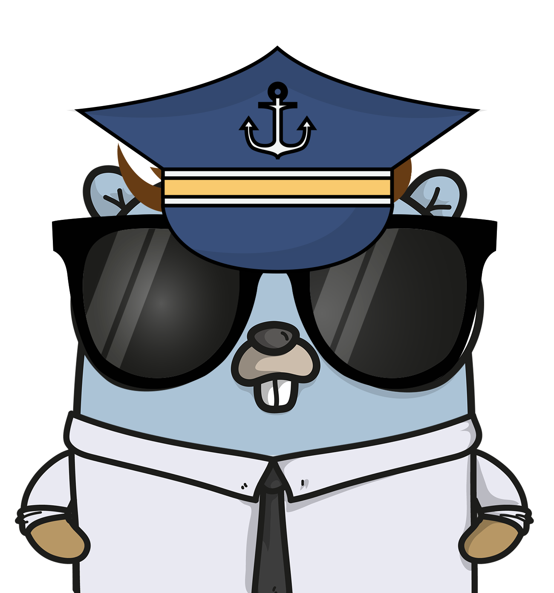
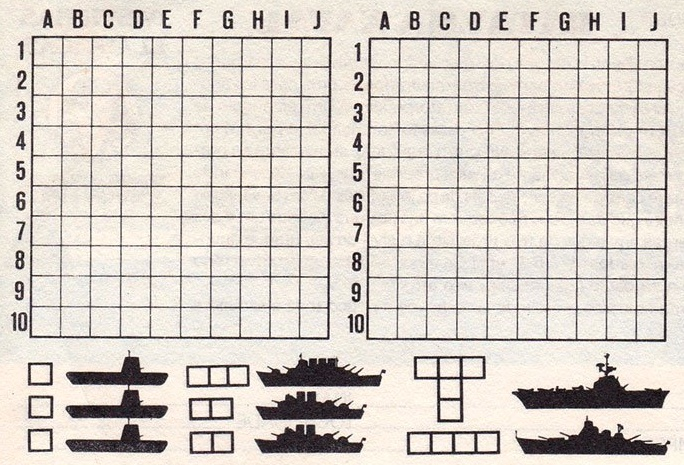

# Battleship



Até os anos 90 era comum encontrar em papelarias um bloco de papel que continha instruções para um jogo simples, mas que poderia vir a se tornar bem divertido se jogado com as pessoas certas. Nas folhas desse bloco continha duas matrizes de `10x10` organizadas entre numeros e letras, ou seja, matrizes de `10xJ`.

Uma dessas matrizes representava as casas onde você dispõe suas "peças" e nas outras você faz marca as jogas que você faz em seu turno. Além das duas matrizes, o bloco possuia uma indicação de como deveria ser o modelo de cada uma das peças que você deveria utilizar. Uma legenda por assim dizer. As formas das peças variavam e os próprios nomes também. Porta-aviões, destroyers, contratorpedeiros, rebocadores, submarinos etc. Todos poderiam participar dependendo da versão que havia sido definida.

Pronto. Nisso se compunha um jogo de **Batalha Naval** antes de você ter opções sofisticadas que hoje rodam até mesmo em smartphones de formas muito mais elaboradas que um simples bloco de papel.

No ano de 1990 e pouco, esse era o jogo que unia a mim e ao meu pai durante dias. Meu pai era professor na extinta Escola Politécnica de Araruama e também era um programador rudimentar de [Basic](https://pt.wikipedia.org/wiki/BASIC), mas que fazia bem o que se propunha a fazer. E em uma dessas oportunidades, ele fez um Jogo de Batalha Naval em Basic - com interface gráfica e tudo. Infelizmente na época não existia um repositório como esse para guardar seus códigos e o jogo foi gravado em um frágil disquete 3,5 e se perdeu pouco depois de ter sido construído. Uma tragédia lamentável. Como eu não tinha computador em casa, ficava limitado a jogar no laboratório da escola e, portanto, não aproveitei tantas vezes quanto gostaria.

Bom. Memórias boas não precisam ficar apenas nas nossas mentes. Então o propósito desse projeto é recriar um jogo simples de Batalha Naval para reavivar a memória de um pai tão magnífico quanto o meu e, de quebra, me fazer voltar alguns anos no tempo em que isso era uma atividade que tanto nos unia. A diferença é que esse projeto não será feito em Basic, mas em [Go](https://go.dev) (desculpa, pai, mas Basic já é demais). E ainda assim, acredito que será um bom paralelo, pois Basic era a linguagem que ele se dedicava e, 20 anos depois, Go é a que eu tenho me dedicado.

Em memória de Julio Ollivier.

## O jogo

O tabuleiro do jogo é constituído por uma matriz de 10x10 onde as escalas são dispostas da seguinte forma:

- Colunas verticais marcadas de 1 a 10
- Colunas horizontais de A a J

Este jogo é recomendado para duas pessoas. Ambos os jogadores devem posicionar seus Navios de Combate em sua matriz 10xJ.

- O primeiro jogador dispara indicando uma posição da Matriz. Exemplo: A1, B3, J10.
- Caso ele acerte, tem o direito de efetuar mais um disparo.
- Caso erre, é considerado um tiro na água e a vez passa a ser do outro jogador.
- Quando todas as partes de um Navio são acertadas o mesmo é considerado como "Afundado"
- Quem afundar todos os Navios do oponente, **ganha o jogo**

A frota segue a cartela de papel original:



Navio            | Tamanho | Quantidade | Formato
---------------- | ------- | ---------- | -------
Submarino        | 1       | 3          | 1 casa
Destroyer        | 2       | 2          | Linha de 2 casas
Cruzador         | 3       | 1          | Linha de 3 casas
Encouraçado      | 4       | 1          | Linha de 4 casas
Porta-Aviões     | 5       | 1          | T: 3 casas em linha e 2 descendo do meio

São 8 navios, que ocupam 19 casas. Os navios em linha podem ser posicionados na horizontal ou na vertical. O Porta-Aviões pode ser posicionado em qualquer uma das 4 orientações do T:

```
■■■     ■       ■   ■
 ■      ■     ■■■   ■■■
 ■     ■■■      ■   ■
```

Os navios não podem se sobrepor nem encostar uns nos outros, nem pela diagonal: sempre há pelo menos uma casa de água entre dois navios.

### Submarino

**Descrição**: Submarino é uma embarcação especializada para operar submersa, tendo sido largamente usada pela primeira vez na Primeira Guerra Mundial, sendo empregada por todas as grandes marinhas atualmente. Submarinos civis e submergíveis são usados com fins científicos tanto na água doce quanto salgada para trabalhar em profundidades muito grandes para mergulhadores humanos. **Fonte:** [Wikipedia](https://pt.wikipedia.org/wiki/Submarino)

### Destroyer

**Descrição**: Um contratorpedeiro, também referido como Destroyer ou Destróier, é um tipo de navio de guerra, rápido e manobrável, concebido para escoltar navios maiores numa esquadra naval ou comboio de navios e defendê-los contra agressores menores, mas perigosos. **Fonte:** [Wikipedia](https://pt.wikipedia.org/wiki/Contratorpedeiro)

AKA: Contratorpedeiro, Destróier

### Cruzador

**Descrição**: Um cruzador é um tipo de navio de guerra. Designando originalmente qualquer navio encarregado de tarefas de exploração em uma esquadra, o termo "cruzador" passou a designar, no final do século XIX, um tipo específico de navio oceânico, maior e mais armado que as fragatas, que acabou por substituí-las. **Fonte:** [Wikipedia](https://pt.wikipedia.org/wiki/Cruzador)

### Encouraçado

**Descrição**: Um couraçado ou encouraçado é um navio de guerra pesadamente blindado e armado com as peças de artilharia de longo alcance e de maior calibre existentes. Normalmente, os couraçados eram maiores, mais armados e mais blindados que os cruzadores e contratorpedeiros. **Fonte:** [Wikipedia](https://pt.wikipedia.org/wiki/Coura%C3%A7ado)

AKA: Couraçado

### Porta Aviões

**Descrição**: Um porta-aviões é um navio de guerra cujo papel principal é servir de base aérea móvel. Permite, portanto, que uma força naval possa projetar o seu poderio aéreo a grandes distâncias, sem a necessidade de depender de aeroportos para os seus aviões. **Fonte:** [Wikipedia](https://pt.wikipedia.org/wiki/Porta-avi%C3%B5es)

## Instalar

### Com Go instalado

```
go install github.com/marcopollivier/battleship@latest
battleship
```

O `go install` coloca o `battleship` na pasta de binários do Go (`$(go env GOPATH)/bin`, normalmente `~/go/bin`). Se o comando `battleship` não for encontrado, coloque essa pasta no `PATH`.

### Sem Go

Na [página de releases](https://github.com/marcopollivier/battleship/releases), baixe o arquivo do seu sistema na versão mais recente:

Sistema | Arquivo
------- | -------
macOS (Apple Silicon: M1, M2...) | `battleship-<versão>-darwin-arm64`
macOS (Intel) | `battleship-<versão>-darwin-amd64`
Linux (64 bits) | `battleship-<versão>-linux-amd64`
Linux (ARM 64 bits, como o Raspberry Pi) | `battleship-<versão>-linux-arm64`
Windows (64 bits) | `battleship-<versão>-windows-amd64.exe`

No macOS e no Linux, dê permissão de execução e rode pelo terminal, na pasta do arquivo:

```
chmod +x battleship-v1.0.0-darwin-arm64
./battleship-v1.0.0-darwin-arm64
```

No Windows, rode o `.exe` pelo terminal (Prompt de Comando ou PowerShell), na pasta do arquivo: `.\battleship-v1.0.0-windows-amd64.exe`.

Os binários não são assinados, então o sistema pode avisar que o programa não foi verificado:

- **macOS:** se aparecer que o programa "não pode ser aberto", libere com `xattr -d com.apple.quarantine battleship-v1.0.0-darwin-arm64`, ou em Ajustes do Sistema → Privacidade e Segurança → "Abrir Mesmo Assim".
- **Windows:** se o SmartScreen avisar, clique em "Mais informações" e depois em "Executar assim mesmo".

### Versão

`battleship --versao` mostra a versão instalada, como `battleship v1.0.0`. Rodando do repositório (`make run` ou `make build`), aparece `battleship (desenvolvimento)`.

### Publicar uma versão (para quem mantém o projeto)

Antes, `make release-check` compila os 5 binários em `dist/` para conferir. Depois, na `master` atualizada, crie e envie a tag da versão:

```
git tag v1.0.0
git push origin v1.0.0
```

O workflow `Release` do GitHub compila os binários e publica a release `v1.0.0`, com as notas geradas a partir dos PRs. Se ele falhar, corrija num PR, apague a tag (`git push origin :v1.0.0` e `git tag -d v1.0.0`) e crie de novo.

## Como jogar

Com Go instalado, rode `make run` (ou `go run .`). Primeiro você arma a sua frota; o computador arma a dele em segredo. Você atira primeiro; quem acerta atira de novo, e quem erra passa a vez. Ganha quem afundar primeiro a frota inteira do outro:

```
Porta-Aviões, 5 casas (cima, baixo, esquerda, direita): E5 baixo
Encouraçado, 4 casas (horizontal, vertical): a1 h
...
Submarino, 1 casa: J10
Frota posicionada!

Disparo: b7
Seu disparo em B7: Água.
A máquina atirou em H3: Acerto!
A máquina atirou em D4: Água.
...
Disparo: e1
Seu disparo em E1: Afundou o Encouraçado!
...
Você venceu! Afundou a frota inimiga em 52 disparos.
Placar no nível dificil: 3 vitórias, 2 derrotas. Melhor vitória: 41 disparos.
Semente: 1729901234
```

A cada jogada, a tela é limpa e mostra os dois tabuleiros lado a lado: `Sua frota` (seus navios e os tiros da máquina) à esquerda e `Frota inimiga` (os seus tiros) à direita. Embaixo vem o que aconteceu desde a tela anterior, o seu disparo e os da máquina, e depois o pedido do próximo disparo:

```
Sua frota                  Frota inimiga
   A B C D E F G H I J        A B C D E F G H I J
 1 ~ C C C ~ ~ ~ ~ ~ ~      1 S o . . . . . . . .
 2 ~ ~ ~ ~ ~ ~ ~ ~ ~ ~      2 . . . . . . . . . .
 3 D ~ ~ E E E E o ~ ~      3 . . . . . . . . . .
...
10 ~ ~ ~ ~ ~ ~ ~ ~ ~ ~     10 . . . . . . . . . .

Sua frota: ~ água, S D C E P navio, X atingido, # afundado, o tiro na água
Frota inimiga: . não atingida, o água, X acerto, S D C E P navio afundado

Seu disparo em B1: Água.
A máquina atirou em H3: Água.
Disparo:
```

No fim da partida, a última tela mostra as duas frotas inteiras, com os navios inimigos revelados.

- Para armar a frota, digite a casa e a orientação de cada navio, como `E5 vertical` ou `e5 v`. A casa é a primeira do navio (a de cima ou a da esquerda); no Porta-Aviões, é o meio da barra do T. O Submarino só precisa da casa.
- Enquanto arma a frota, `aleatorio` sorteia os navios que faltam, `desfazer` tira o último navio posicionado e `recomecar` tira todos os navios. Se os navios que faltam não couberem mais no tabuleiro, o jogo avisa antes de pedir o próximo.
- Na partida, digite uma coordenada por vez, como `B7` ou `j10`.
- Digite `sair` (ou aperte Ctrl+D) para desistir e ver onde estavam os navios inimigos.

### Placar

O jogo guarda, para cada nível, as suas vitórias e derrotas contra a máquina e a melhor vitória (a de menos disparos). Só contam as partidas com a frota da cartela, sem `--frota`; o modo solo não conta. Desistir depois do primeiro disparo conta como derrota; desistir enquanto arma a frota, ou antes de atirar, não conta. No fim de cada partida que conta, aparece o placar do nível jogado.

O placar fica no arquivo `placar.json`, na pasta `battleship` da pasta de configuração do usuário: `~/Library/Application Support/battleship/placar.json` no macOS, `~/.config/battleship/placar.json` no Linux (ou em `$XDG_CONFIG_HOME`) e `%AppData%\battleship\placar.json` no Windows. Se não der para ler ou gravar o arquivo (por exemplo, se ele estiver corrompido), o jogo avisa `Não foi possível guardar o placar.` e segue normalmente; `--zerar-placar` começa um placar novo.

As opções vão em `ARGS`, como em `make run ARGS="--frota S=2,P=1 --semente 42"`, ou depois de `go run .`, como em `go run . --frota S=2,P=1 --semente 42`:

Opção | Exemplo | O que faz
----- | ------- | ---------
`--frota` | `--frota S=2,D=1,P=1` | Escolhe quantos navios de cada tipo, pelas letras da legenda: `S` Submarino, `D` Destroyer, `C` Cruzador, `E` Encouraçado, `P` Porta-Aviões. Sem a opção, vale a frota da cartela.
`--semente` | `--semente 42` | Repete uma partida anterior: o tabuleiro da máquina, os navios sorteados com `aleatorio` e os tiros da máquina, desde que você digite as mesmas coisas e use o mesmo nível. A semente aparece no fim de cada partida.
`--modo` | `--modo solo` | `maquina` (padrão) joga contra a máquina; `solo` só ataca um tabuleiro sorteado, sem a máquina atirar de volta.
`--nivel` | `--nivel facil` | `dificil` (padrão): a máquina joga como quem joga no papel, sorteia casas até acertar um navio e então atira em volta do acerto até afundá-lo, sem atirar nas casas encostadas num navio já afundado. `facil`: a máquina sorteia todos os tiros. `mestre`: a máquina sabe quais navios ainda faltam e atira onde mais deles ainda caberiam, pelo que ela já viu; depois de um acerto, ela segue o navio para o lado em que ele cabe.
`--placar` | `--placar` | Mostra o placar dos três níveis e termina, sem começar partida.
`--zerar-placar` | `--zerar-placar` | Apaga o placar e termina, sem começar partida.
`--cores` | `--cores nao` | Pinta os tabuleiros e as mensagens de acerto, água, navio afundado, fim de partida e entrada inválida. `auto` (padrão) usa cores só quando a saída é um terminal e a variável `NO_COLOR` não está definida (ou está vazia), então `go run . > partida.txt` e `go run . \| less` saem sem cores; `sim` usa cores sempre, mesmo com `NO_COLOR`; `nao` nunca usa.
`--limpar` | `--limpar nao` | Limpa a tela antes de cada jogada e antes de cada navio a posicionar. `auto` (padrão) limpa só quando a saída é um terminal, então `go run . > partida.txt` guarda as telas uma embaixo da outra; `sim` limpa sempre; `nao` nunca limpa.
`--versao` | `--versao` | Mostra a versão do jogo e termina, sem começar partida.

## TODO - Evolução do projeto

- [x] Permitir que uma pessoa ataque um tabuleiro armado aleatoriamente
- [x] Permitir que arme seu próprio tabuleiro e jogue contra a máquina e jogadas aleatórias
- [x] Permitir que a pessoa defina a quantidade de navios que ela quer jogar
